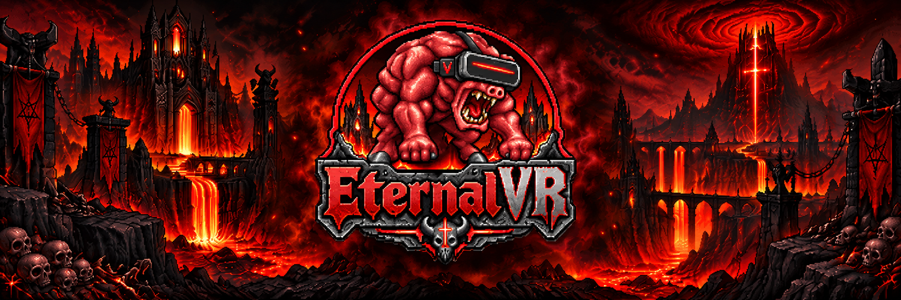

# EternalVR

> **Alpha.** Testers welcome.

**Hell in your headset.** A free VR mod for DOOM Eternal on PC (Steam, Game Pass or Microsoft Store),
through OpenXR.

Most of the feedback and chat happens in the EternalVR thread on the Flat2VR Discord:
**[join the Discord](https://discord.gg/ZFSCSDe)**, then
**[go to the EternalVR thread](https://discord.com/channels/747967102895390741/1554248586126954527)**
(that link works once you're in the server).

## Features

- True stereo, with 6DoF head tracking, seated or standing.
- Motion controllers with hand aiming: the gun goes where your hand points, with its sights lined up.
- Both arms follow your hands, with a free off hand. Left-handed play, and the arms shown, hidden or just the
  hands.
- Punch for real to melee, glory kill a staggered demon or Blood Punch.
- Room-scale: walk around your room and the Slayer walks with you.
- The weapon wheel on the right stick or by pointing with your hand, and every tutorial and popup action
  on a button.
- Weapon switching from the thumb rest on Quest and Rift controllers: rest one thumb and pick with the
  other stick, flick toward a weapon, or play standing with the turn stick picking (off by default, on the
  Play tab).
- Roll your weapon hand's wrist to switch the weapon mod.
- Optional gestures (off by default): swing down from above your head for the Crucible or the Hammer, throw
  both hands up to jump.
- The HUD on a panel in front of you, or on your wrist or your weapon (experimental). Menus on a panel with a
  laser pointer. Cutscenes on a big screen, in 3D.
- Comfort options: smooth or snap turning, a vignette, and four ways to see glory kills (follow the camera, a
  steady view, a fade, or a flat screen).
- Every control can be changed in the launcher's controls editor, the thumb rests included.
- Controller vibration for shots, punches, the game's own rumble and menu clicks.
- bHaptics vest and sleeves (experimental): hits from the direction they came, glory kills, landings,
  portals and more.
- A desktop window mirroring the game for people watching.
- The full campaign and both DLC (single-player only).
- Full ray tracing support: the testing so far has been at maximum settings with ray tracing on.
- DLSS in both eyes, with NVIDIA's newest DLSS one click away in the launcher, and a sharpening setting.
- Foveated rendering on NVIDIA RTX cards (experimental), and Parallel Eye Rendering, a highly experimental
  way to draw both eyes as two views of one game frame.
- A launcher that checks your game version, sets everything up for the session and restores your
  settings afterwards.

## Planned

No dates yet:

- **A more immersive VR HUD** (a priority): the wrist and weapon HUDs finished, so health, armour and ammo
  live on you instead of a floating panel.
- Two-handed grips for the bigger guns.
- More VR interactions with the world, beyond punching.
- Optimizations, especially on the processor side, for more frames on more PCs.

## Headsets, and I need testers

It should work with any PC VR headset that has an OpenXR runtime: Virtual Desktop, SteamVR, Meta
Horizon Link and others. So far it has been tested on a Quest 3, through Virtual Desktop and through
SteamVR, with an RTX 4080 and an RTX 3080 Ti, and a tester has played it on a PlayStation VR2 with an RTX
4060.

Under SteamVR the left Menu button opens SteamVR's own dashboard, so **hold Y to pause** instead.

Controllers with bindings: Quest (Touch) and Valve Index, plus Steam Frame, HP Reverb G2, Windows Mixed
Reality, HTC Vive Cosmos, HTC Vive wands and Pico 4. I play with the Quest controllers, and players have
been using Valve Index ones; the rest are untested, so reports from anyone with them are especially
welcome. Their layouts are in [`docs/release/CONTROLS.md`](docs/release/CONTROLS.md).

On AMD Radeon RX 5000 and 6000 cards (and with some newer AMD drivers) each eye renders at the size of the
game's desktop window and looks soft. A virtual display shaped like a headset eye works around it today;
see "The picture is soft on an AMD graphics card" in
[`docs/release/TROUBLESHOOTING.md`](docs/release/TROUBLESHOOTING.md).

If you try it on anything else (another headset or runtime, an AMD or Intel graphics card), please
tell me how it went, good or bad, on the [Discord](https://discord.gg/ZFSCSDe), in an
[issue](../../issues/new/choose) or in [Discussions](../../discussions). Bug reports, ideas and pull
requests are all welcome.

See [`docs/release/KNOWN-ISSUES.md`](docs/release/KNOWN-ISSUES.md) for what does not work yet, and
[`docs/ROADMAP.md`](docs/ROADMAP.md) for the plan.

This is an unofficial fan project. It is not affiliated with or endorsed by id Software, Bethesda or
ZeniMax. DOOM is a trademark of id Software / ZeniMax Media Inc. You need a legal copy of DOOM Eternal.
No game assets are distributed.
The code is MIT-licensed (`LICENSE`); the EternalVR name and logo are not (`branding/README.md`).

## Requirements

- Windows 10 or 11.
- DOOM Eternal on Steam (build 25216728), or on Game Pass or the Microsoft Store (version 1.0.56.0); the
  launcher shows whether yours is supported. With both installed, it uses the Steam copy unless you pick
  the other one's folder on the Advanced tab.
- A PC VR headset with an OpenXR runtime (see above for what has been tested).

## Download and install

Download the latest zip from [GitHub Releases](../../releases) and follow
[`docs/release/INSTALL.md`](docs/release/INSTALL.md). Nothing is installed into Windows or into the game
folder. [`docs/release/TROUBLESHOOTING.md`](docs/release/TROUBLESHOOTING.md) explains the launcher's
messages.

## Controls

Every button is listed in [`docs/release/CONTROLS.md`](docs/release/CONTROLS.md). To change them, click
**Edit controls...** on the launcher's Play tab: it lists every button of your controllers and refuses
controls the game could not use. See
["Changing the controls"](docs/release/CONTROLS.md#changing-the-controls) there.

## Reporting bugs

Open a [GitHub issue](../../issues/new/choose) with the bug template, or post in the EternalVR thread
on the [Discord](https://discord.gg/ZFSCSDe). In the launcher, click
**Export report...** and attach the zip: it holds the launcher and mod logs with your user name and Steam
account ID removed, and the dialog lists every file before you save it. Check
[`docs/release/KNOWN-ISSUES.md`](docs/release/KNOWN-ISSUES.md) first.

**Something looks wrong in one eye, or different between your eyes?** Take a capture in the headset at that
spot: hold the **left Menu** button and pull a **trigger**. It saves each eye separately plus the HUD, and the
game doesn't pause or fire. On SteamVR with Quest/Rift controllers the left Menu button opens the SteamVR
dashboard, so there you hold **both sticks pressed** and pull a trigger instead. **Export report...** puts your
latest captures in the zip by itself. They're also on your PC in `%LOCALAPPDATA%\EternalVR\logs\<session>\captures\`
(a `-L.png` and `-R.png` per capture). A normal screenshot or a Virtual Desktop one only shows one eye, so for
these bugs the capture is what helps.

## Ideas and questions

Come say hi on the [Discord](https://discord.gg/ZFSCSDe), or use [GitHub Discussions](../../discussions) for
ideas, questions and setups that work (or do not).

## Support

EternalVR is free and stays free. If you want to support it:
[ko-fi.com/FanciestPeanut](https://ko-fi.com/FanciestPeanut).

## Layout
- `docs/SCOPE.md`: what I am building, requirements, in and out of scope
- `docs/DECISIONS.md`: decision log
- `docs/ARCHITECTURE.md`: design baseline
- `docs/ROADMAP.md`: milestones with done-when criteria
- `docs/PLAN_M1_M3.md`, `docs/RIG_BRINGUP.md`: task plan for the next milestones and the rig runbook
- `docs/research/`: research notes behind the design; `docs/notes/`: short fact sheets they rely on
- `reference/MANIFEST.md`: index of the third-party documentation the research used (not redistributed;
  `tools/fetch_references.sh` fetches the public sources into `reference/`)
- `src/`, `tests/`, `tools/`, `launcher/`: the layer, its tests, rig tools and the launcher (see `CONTRIBUTING.md` to build and test)
- `docs/release/`: the alpha's install, controls, known issues and troubleshooting
- `branding/`: the logo and the launcher icon
- `THIRD_PARTY_NOTICES.md`: origins and licences of third-party code

## Thanks

To everyone who has played the test builds, sent exports, filed issues and told me what felt off in the
headset: thank you, EternalVR is a lot better because of you.

cocofr69-cmd, cyto, DamicsITA, Fye, genfgenfgenf-git, H-Bomb777, HansGruber45, HugeLarry, Immolation,
JamimaPanAm, jmcglath, John2910, Lieuuutenant Dan, MalebolgiaXX, nm9512, nsmmm, ObtuseMulberry, sdd25,
ShinChiller, SilentBang, STRiPEALiPE, thet0x1n, Twip, Ventofreddo, vinion, yodaui

Extra thanks to vinion for the AMD and Intel foveated rendering (#33).

Tested it and not on the list? Tell me on Discord or in an issue and I'll add you.

## Acknowledgements
Thanks to the wider Flat2VR community. Any code adapted from other projects is listed in
`THIRD_PARTY_NOTICES.md`.

Thanks to [KHARVOX](https://github.com/CactusVRStudios/KHARVOX), a DOOM 2016 VR mod, whose ideas informed some of EternalVR's design.
